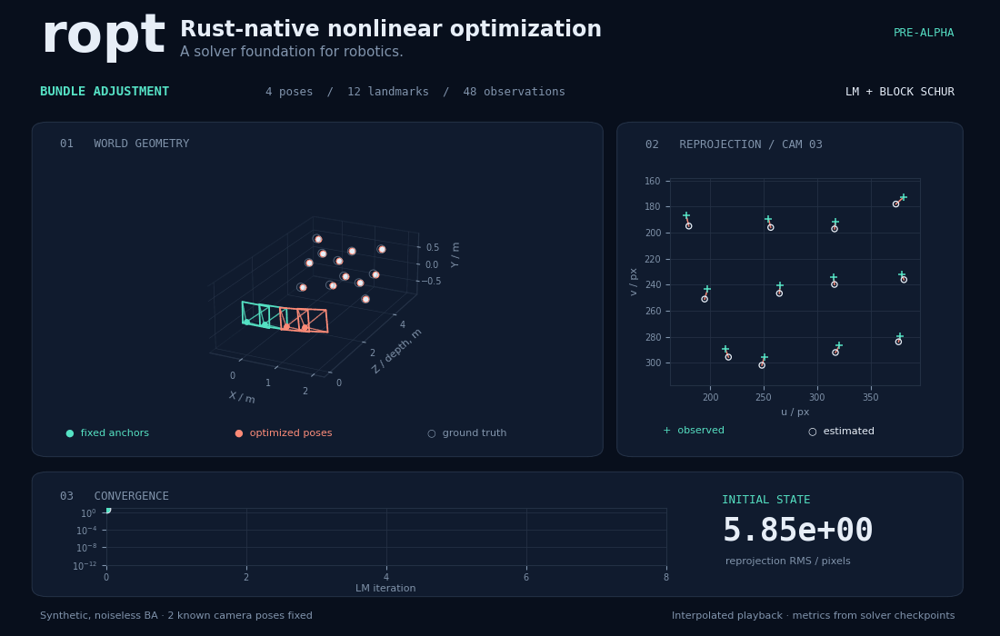

# ropt

**A Rust-native nonlinear optimization library for robotics.**

[](https://github.com/rsasaki0109/ropt/actions/workflows/ci.yml)
[](#license)

Dense and sparse nonlinear least squares, automatic differentiation, Lie groups,
and factor graphs. Pure Rust dependencies, with no C++ runtime or FFI.
**Experimental / pre-alpha.**



*Synthetic bundle adjustment: 4 cameras, 12 landmarks, 48 observations.
Two known camera poses anchor the frame and scale. Actual LM + block Schur
checkpoints; playback is interpolated. This is a convergence demonstration,
not a runtime or comparative performance benchmark.*

Run it: `cargo run -p ropt --example bundle_adjustment --locked`.
[Reproduce the GIF](docs/visualization/README.md).

## Implemented

- Dense Gauss–Newton using SVD with explicit rank failure.
- Levenberg–Marquardt with scaled damping, predicted/actual improvement ratio,
  accepted/rejected trials, adaptive damping, and iteration records.
- Gradient, accepted-step, cost-change, iteration-limit and stagnation outcomes.
- Squared, Huber and Cauchy loss per **scalar** residual, using IRLS.
- Analytic `Residual` trait, fixed-size forward-mode `Jet`, explicit central differences.
- Contiguous parameter block ranges; the solver operates on their flattened vector.
- SO(2), SO(3), SE(2), SE(3) Exp/Log, composition, inverse, right retract/local;
  Euclidean retract/local. SE(3) tangent ordering is translation then rotation.
- `LocalProblem` / `solve_local` optimize with tangent Jacobians and right retractions.
- `FactorGraph` with dense and CSR assembly, graph-owned variable IDs, fixed blocks,
  analytic or explicitly requested numeric factors, and a small anchored SE(3) chain with loop closure.
- Canonical CSR matrices, Jacobi-preconditioned CG with true-residual checks, and
  matrix-free sparse LM normal operators. Dense mode remains the default.
- A dense Schur elimination reference backend for LM.
- CSR-based independent-block Schur elimination with a matrix-free reduced PCG
  solve, analytic pinhole reprojection factors, and synthetic Bundle Adjustment.

The initial Cargo workspace has one crate; module boundaries avoid premature
splitting and circular dependencies.

## Develop

Rust 1.99.0 is pinned in `rust-toolchain.toml`. Dependencies are locked.

```sh
cargo test --workspace --all-targets --locked
cargo fmt --all --check
cargo clippy --workspace --all-targets --locked -- -D warnings
cargo run -p ropt --example rosenbrock --locked
cargo run -p ropt --example pose_graph_2d --locked
cargo run -p ropt --example pose_graph_3d --locked
cargo run -p ropt --example bundle_adjustment --locked
cargo doc --workspace --no-deps --locked
```

On this managed cloud machine first export:

```sh
export RUSTUP_HOME=/workspace/.ropt-toolchain/rustup
export CARGO_HOME=/workspace/.ropt-toolchain/cargo
export PATH="$CARGO_HOME/bin:$PATH"
cd /workspace/ropt
```

## Minimal usage

```rust
use ropt::{autodiff::{AutoDiff, Jet}, solve, DVector, Options};

fn main() -> Result<(), ropt::Error> {
    let residual = AutoDiff::<1, 1, _>(|x: [Jet<1>; 1]| [x[0] - Jet::constant(3.0)]);
    let report = solve(&residual, DVector::zeros(1), &Options::default())?;
    assert!((report.x[0] - 3.0).abs() < 1e-7);
    Ok(())
}
```

Inspect `Report::termination`; an iteration limit or `NoProgress` does **not**
prove convergence. Evaluation failures and nonfinite results return errors.
GN has no line search and reports `NoProgress` when its full step fails to improve.
LM's robust model is a first-order IRLS approximation; it is not the full robust
Hessian. The dense LM normal equations square the condition number, so scaling
and conditioning matter. Sparse LM uses a matrix-free normal operator, which
still inherits the conditioning of normal equations. No real-time suitability
or performance advantage is claimed.

## Scope still missing

Sparse direct factorization, heterogeneous/coupled eliminated Schur blocks,
dynamic-dimensional AD, parallel evaluation, marginalization, per-factor
whitening/loss policies, GNSS examples and comparative benchmarks. BA currently
uses an undistorted calibrated pinhole model and synthetic observations only.
Sparse LM currently uses PCG with
Jacobi preconditioning; difficult conditioning can require stronger preconditioners.
The SE(2) example uses absolute Exp coordinates and **explicit numerical
Jacobians**; it is not a complete factor graph or manifold solver.

Exp/Log use principal rotations, with the usual ambiguity at pi; inputs to the
standalone manifold primitives must be finite. No global convergence guarantees.
This is not yet production-ready or equivalent to GTSAM, Ceres, or g2o.

## Factor graph and manifold solves

`VariableKind` defines ambient storage and right tangent updates. SO3 stores
`[w,x,y,z]`; SE3 stores `[tx,ty,tz,w,x,y,z]` and uses a six-dimensional tangent.
Input quaternions must have unit norm within 1e-8. Variable IDs belong to their graph.
`set_fixed` excludes a block's tangent columns and preserves its ambient values.
An all-fixed graph evaluates its cost without taking any steps.

Analytic factors return a Jacobian block for every connected variable, ordered as
registered and differentiated with respect to **right tangent increments** (even
for fixed variables). Numeric factors explicitly differentiate `retract(x, +/-h)`;
fixed variables are not differentiated. Neither path silently falls back to the
other. Factors must have distinct variable IDs. Loss in `Options` applies globally
per scalar residual; correlated measurement whitening is the caller's responsibility.
`solve_local` step tolerance uses a dimensionless scale of 1 for graphs; choose
appropriate units and tolerances when mixing translation and rotation.

```rust
use ropt::{factor::{FactorGraph, VariableKind}, solve_local, DVector, DMatrix, Options};

fn main() -> Result<(), ropt::Error> {
    let mut graph = FactorGraph::new();
    let anchor = graph.add_variable(VariableKind::Euclidean(1), DVector::from_element(1, 3.0))?;
    let estimate = graph.add_variable(VariableKind::Euclidean(1), DVector::zeros(1))?;
    graph.set_fixed(anchor, true)?;
    graph.add_analytic_factor(&[anchor, estimate], 1, |v| {
        Ok((&v[1] - &v[0], vec![-DMatrix::identity(1, 1), DMatrix::identity(1, 1)]))
    })?;
    let result = solve_local(&graph, graph.initial(), &Options::default())?;
    assert!((graph.value(&result.x, estimate)?[0] - 3.0).abs() < 1e-7);
    Ok(())
}
```

## Linear solver selection

`Options::linear_solver` selects a backend. `Dense` uses SVD for GN and Cholesky
for LM. `SparseCg(CgOptions)` uses CSR Jacobians and computes `Jᵀ(Jv)` without
storing a global dense Jacobian or normal matrix. Only LM is supported for sparse
CG: there is no rank-revealing sparse GN solve yet. Factor callbacks still create
small dense local Jacobian blocks, and assembly is rebuilt each linearization.

`FactorGraph` implements sparse evaluation directly. Custom `LocalProblem`
implementations must implement `evaluate_sparse`; selecting sparse mode on an
unsupported problem returns an error. No silent dense fallback is performed.
The original `Residual`/`solve` adapter remains dense-only.

```rust
use ropt::{factor::{FactorGraph, VariableKind}, sparse::CgOptions,
           solve_local, DVector, DMatrix, LinearSolver, Options};

fn main() -> Result<(), ropt::Error> {
    let mut graph = FactorGraph::new();
    let id = graph.add_variable(VariableKind::Euclidean(1), DVector::zeros(1))?;
    graph.add_analytic_factor(&[id], 1, |v| {
        Ok((v[0].clone() - DVector::from_element(1, 3.0), vec![DMatrix::identity(1, 1)]))
    })?;
    let options = Options {
        linear_solver: LinearSolver::SparseCg(CgOptions::default()),
        ..Options::default()
    };
    let result = solve_local(&graph, graph.initial(), &options)?;
    assert!((result.x[0] - 3.0).abs() < 1e-7);
    Ok(())
}
```

PCG uses a zero initial guess, Jacobi preconditioning, and a stopping threshold
`max(absolute_tolerance, relative_tolerance * ||rhs||)`. It verifies the true
`rhs - A*x` residual before success. Nonpositive curvature, nonfinite values and
iteration exhaustion produce errors; LM propagates them. `Iteration::linear_iterations`
reports PCG work, and is zero for direct solves. These criteria certify the linear
residual only, not the accuracy of the solution for ill-conditioned systems.

`DenseSchur { retained: k }` retains the first `k` active tangent columns and
eliminates the trailing columns. It is LM-only, with `0 < k < tangent_dimension`.
It factors the eliminated block, solves the reduced system, then back-substitutes;
no explicit inverse is computed. It still allocates dense matrices and is a
reference for later sparse block elimination. `sparse::schur_solve` exposes the
standalone SPD solve. The SE3 example runs both dense and sparse LM.

## Block Schur and Bundle Adjustment

`BlockSchur { retained, block_size, cg }` selects CSR-based Schur elimination for
LM. The active tangent vector must contain a retained prefix, followed by equally
sized independent eliminated blocks. `FactorGraph::schur_layout(&landmark_ids)`
checks that ordering, ignores fixed IDs, checks equal sizes and rejects factors
that connect multiple active eliminated variables. Register cameras before points.
A residual row coupling different eliminated blocks is also rejected by the
linear backend; unsupported coupling is never discarded.

Each eliminated block is factored with a small dense Cholesky decomposition.
Retained Jacobian entries and cross-block rows are stored sparsely. The reduced
operator applies `A*v - B*C^-1*Bᵀ*v` through block solves; neither the full normal
matrix nor the reduced Schur matrix is stored densely. Back-substitution recovers
landmark increments. The final linear residual is checked against the **full**
damped normal system; `LinearResidualTooLarge` reports a failed accuracy check.
Jacobi preconditioning and cancellation in Schur reduction can limit difficult
problems; no large-scale performance advantage has been demonstrated.

```rust
use ropt::{factor::{FactorGraph, VariableId}, sparse::CgOptions,
           solve_local, LinearSolver, Options, Report, Error};
fn optimize_ba(graph: &FactorGraph, points: &[VariableId]) -> Result<Report, Error> {
    let (retained, block_size) = graph.schur_layout(points)?;
    let options = Options {
        linear_solver: LinearSolver::BlockSchur {
            retained, block_size, cg: CgOptions::default()
        },
        ..Options::default()
    };
    solve_local(graph, graph.initial(), &options)
}
```

`camera::Pinhole` uses fixed `fx, fy, cx, cy`. Poses are camera-to-world SE3;
landmarks are Euclidean world coordinates. `camera::add_reprojection_factor`
registers analytic derivatives with respect to right pose increments and world
point coordinates. The residual is prediction minus measured pixel coordinates.
It does not select numerical differentiation or optimize intrinsics/distortion.
Points behind the camera or within 1e-8 of its projection plane cause evaluation
errors. Such invalid trial evaluations abort the solve; cheirality-aware trial
rejection and global initialization are not implemented.

`bundle_adjustment` builds 4 cameras, 12 points and 48 observations with all points
visible. Two known camera poses are fixed to anchor the world frame and metric
scale. It jointly refines the other two poses and all points. Both dense and block
Schur LM reduce initial 2D reprojection RMS of about 5.85 pixels below 1e-7 and
recover the deterministic noise-free state within 1e-6 in regression tests.
A separate deterministic 0.2-pixel-amplitude noise test with Huber loss checks
error reduction and dense/Schur agreement; it does not require exact ground-truth
recovery in the presence of noise. These are small synthetic checks, not validation
on a public BA dataset or a production SLAM pipeline.

## Validation and maturity

Tests cover Rosenbrock convergence and rejected-state preservation, linear GN,
rank deficiency, Huber/Cauchy outliers, derivative agreement, invalid inputs,
termination reasons and Lie group roundtrips near zero and pi. Graph tests cover
fixed blocks, analytic SO3 tangent Jacobians versus manifold central differences,
SE3 chain/loop convergence, quaternion normalization and invalid graph inputs.
Sparse tests check CSR products and duplicate handling, PCG against Cholesky,
true residuals, non-SPD failures, iteration limits, robust LM and rejection state,
Schur against full solves, dense/sparse agreement and a 300-variable anchored chain
with 597 Jacobian nonzeros (versus 299*299 dense entries). Storage counts are not
runtime or overall-memory benchmarks. Block Schur tests independently compare
the reduced operator, diagonal, right-hand side, back-substitution and full-system
residual with dense elimination; projection derivatives are checked against known
signs and manifold central differences. BA tests check noiseless recovery, fixed
anchors, noisy robust optimization and explicit linear-solver failure propagation.

Our informal **20% milestone** means a tested dense solver foundation, not 20%
of another project's speed, feature count or reliability. Comparison target:
GTSAM/Ceres/g2o capability and operational maturity. Suggested rubric: solver
core 25%, differentiation 15%, manifolds/robotics 20%, sparse/scalability 15%,
validation/performance 15%, documentation/maintenance/field evidence 10%.
Current estimate: core 10 + differentiation 4 + manifolds/robotics 9 +
sparse/scalability 7 + validation 4 + documentation 1 = 35/100. The increase from
30 reflects independent-block Schur elimination, analytic reprojection and tested
synthetic BA. This subjective estimate is not a measured comparison. Mature
robotics applications need substantially more work.

## License

Dual licensed under [MIT](./LICENSE-MIT) or [Apache-2.0](./LICENSE-APACHE).
