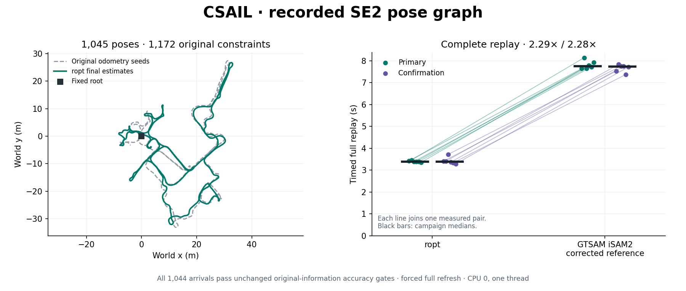

# Complete CSAIL recorded SE2 comparison

ropt is **2.29x faster** in the primary campaign and **2.28x faster** in
independent confirmation, winning **12/12 pairs** with every common-accuracy
gate passing. This broadens the recorded-data evidence beyond Intel.

| Campaign | ropt median | Native median | Native/ropt | Faster pairs |
|---|---:|---:|---:|---:|
| Primary | 3.388 s | 7.755 s | 2.289x | 6/6 |
| Confirmation | 3.385 s | 7.730 s | 2.283x | 6/6 |

This comparison extends the Intel experiments to the **CSAIL recording**,
with 1,045 poses, 1,172 original constraints and all 1,044 inferred arrivals.
It uses the same Cartesian sparse QR/GN ropt policy, precision-corrected native
GTSAM 4.2.1 iSAM2 reference and unchanged common-accuracy gates described in
[the MIT1228 comparison](PRECISE_REAL_ISAM2.md).

## Recorded artifact and initialization

The unmodified source is `data/CSAIL.g2o` from SE-Sync commit
`9b631b6b82d8aa7d32ab846412ae1c070412b7b6`, with SHA-256
`66d99ac857a9849d814d214a9ebd0d4876d5d40f0a37be9330c1ff6e6e9daaa6`.
Section 6.2 of Rosen, Carlone, Bandeira and Leonard's *SE-Sync: A certifiably
correct algorithm for synchronization over the special Euclidean group* (2019)
explicitly identifies CSAIL among the real-world examples. It is a different
recording from Intel. Source URLs, the supporting paper hash and the exact
artifact are saved in [provenance](results/csail_real_isam2/provenance.json).

This artifact contains **edges only**. Unlike the Intel artifacts, it does not
provide vertex seeds. Both solvers receive identical deterministic seeds:
fix pose 0 at `(0,0,0)`, then compose the original 1,044 consecutive odometry
measurements once in ascending pose order. Loop constraints are excluded from
seed generation. This is unoptimized dead reckoning; no truth, batch solution,
random perturbation or solver-specific initializer is used. The initializer
rejects missing or duplicate chain edges, mixed supplied vertices and nonfinite
results. Tests use independent expected geometry and invalid chain examples.

All measurements and information matrices retain their original directed form
and values. No constraints are reversed, pruned or generated. Edges arrive at
their later endpoint, in stable original file order within each arrival.
Pose IDs infer arrivals; this source has no sensor timestamps. The serialized
full stream hash is
`fe3ffed0fdae1d69d0e374a915f3364860602a7fe1ad34d19d6de7571e98718a`.
All information matrices pass the existing SPD checks; none triggers the
compensated small-pivot whitening branch. The native reference remains the
same executable and linked library used for MIT1228.

## Accuracy and timing contract

Both solvers force full nonlinear refresh on every arrival, with the existing
`8e-8` internal original column-normalized gradient target and 200-trial/call
limit. Every measured arrival must pass:

- complete finite poses and the exact fixed root;
- independently evaluated original column-normalized gradient `<=1e-7`;
- reported original cost agreement `<=1e-10 * max(1,cost)`;
- inter-library original cost agreement `<=1e-9 * max(1,cost)`;
- maximum mixed world-pose norm gap `<=2e-6` (metres/radians combined).

The initial complete cold functional replay passed all gates. Its maximum
inter-library pose gap was `3.782e-7` and original cost gap `4.974e-13`.
These cold checks are not the official speed measurement.

Each official campaign uses six alternating AB/BA pairs on CPU 0, one thread,
one discarded full warm-up and one timed full replay per process. No compilation
or numerical test suite runs during timing. Timers include update, full owned
means, cost/report and native stationarity probes; they exclude parsing, factor
construction, independent verification, serialization and report destruction.
Memory is not measured. This is an explicit common-accuracy full-refresh policy,
not default cached iSAM2 latency or a general SLAM speed claim.

The [primary](results/csail_real_isam2/primary/report.json) and
[confirmation](results/csail_real_isam2/confirmation/report.json) archive raw
timing samples, every update and quality check, complete first-pair poses,
options, input streams, source/executable/library hashes and manifests.
Across both campaigns, **25,056 timed arrivals** pass every gate, plus 24
discarded complete warm-up streams. Maximum original column-normalized
gradients are `2.443e-8` for ropt and `7.288e-8` for native; maximum inter-library
pose gap is `3.782e-7` and original cost gap is `4.974e-13`.
Gzip headers are normalized without changing the archived payloads.



The independent [renderer](plot_csail_comparison.py) reads these archived
poses and paired samples directly. It generates a standalone PNG and a
manifest with hashes of its inputs and output; it does not regenerate the
historical Intel showcase. Run `python3 benchmarks/plot_csail_comparison.py`
with Matplotlib installed.

## Reproduce

Use the existing [native build and manifest instructions](PRECISE_REAL_ISAM2.md#reproduction)
and build `benchmark_cartesian_se2_isam` in release mode. Then run:

```sh
OMP_NUM_THREADS=1 OPENBLAS_NUM_THREADS=1 MKL_NUM_THREADS=1 \
  taskset -c 0 python3 benchmarks/paired_real_isam2.py \
  --ropt target/release/examples/benchmark_cartesian_se2_isam \
  --ropt-policy sparse-qr-gn-cartesian \
  --native /tmp/precise-native/gtsam_isam2 \
  --native-manifest /tmp/precise-native-manifest.json \
  --input benchmarks/results/csail_real_isam2/csail-se-sync1045-original.g2o \
  --output /tmp/csail-primary --rounds 6 --cpu 0
```

Repeat with a fresh output directory for independent confirmation. Rust must be
activated on `PATH` for environment metadata collection. An initial attempt
without that activation stopped before launching either solver; it contributes
no timing samples. The Intel conversion regression retains both historical
stream hashes exactly, and production solver source is unchanged by the CSAIL
dataset extension.
