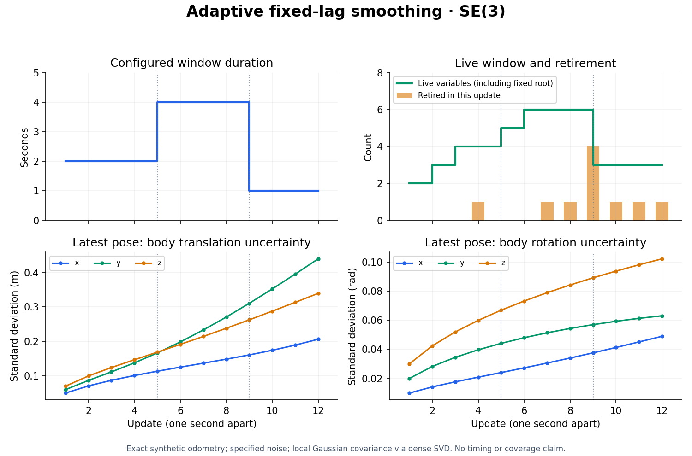

# Retaining poses after fixed-lag expiry

`FixedLagReport::estimates` contains live variables after marginalization.
`marginalized_estimates` contains the last optimized ambient value of every
variable removed by that update. Its keys exactly match `marginalized`, in key
order. An update with no expired variables returns an empty map.
`marginalized_timestamps` has the same keys and preserves each retired variable's
last assigned timestamp, including earlier refreshes. It is the variable time,
not the update's `now` or its cutoff. Persistent variables do not appear there.
The [timestamp snapshot checks](../benchmarks/results/retired_timestamps/manifest.json)
cover mixed SO(3)/fixed SE(3) states, failed timestamp proposals, key reuse, and
robust marginalization's carried constant cost.

The snapshot is taken after optimization, before removal. Observations supplied
in that same update can therefore change the returned final value, even when
its variable is about to expire. Fixed variables are included when they expire;
persistent variables (`timestamp: None`) remain live.

An application can append these owned `(key, value)` pairs to a trajectory log:

```rust,ignore
let report = smoother.update(now, observations)?;
for (key, value) in report.marginalized_estimates {
    let timestamp = report.marginalized_timestamps[&key];
    trajectory.push((key, timestamp, value));
}
// report.estimates still contains the current live window.
```

The vectors use each variable kind's ambient representation, not tangent
increments. They remain available after subsequent updates or after dropping the
smoother. Later observations do not revise retired poses, so the assembled
trajectory is not a newly optimized all-history solution. Retired keys may be
reused; applications needing globally unique records should retain their own
sequence alongside the key and returned timestamp. Timestamps are preserved
exactly as assigned and need not be unique across variables or reused keys.

Snapshots are returned only when the entire update succeeds. Optimization or
marginalization errors leave the smoother's owned state and time unchanged.
Invalid covariance queries also discard newly proposed variables, factors and
timestamp refreshes; a retry uses the previously committed expiry schedule.
The smoother stores no extra history: retaining reports or a trajectory log is
an application choice and consumes memory outside the bounded live window.

Run `cargo run --locked --offline -p ropt --example fixed_lag_odometry` for an SE2
example. It retains 75 retired poses, keeps six live poses at the end of its
80-frame stream, and checks that all 81 poses (including the initial root) are
accounted for. This API addition carries no performance claim.

The fixed-lag integration tests cover refreshed timestamps at the strict cutoff,
multiple simultaneous retirements (including a fixed variable), rejection of
duplicate timestamp refreshes, and reuse of a retired key. Reusing a key does not
alter its value in a previously returned snapshot; persistent variables stay in
the live estimates.

## Factor input dimensions

Factor registration checks the sum of residual counts and the additional
terminal CSR row offset with checked integer arithmetic. Counts that overflow
either value return `Error::InvalidDimensions` before changing the graph or
evaluating callbacks. This applies to analytic, automatic and explicit numeric
factor registration, and to graph construction inside fixed-lag and iSAM updates.

Rejected updates preserve estimates, factors, cached incremental state and time.
A valid retry can proceed normally; a failed timestamp refresh does not change
which variable expires. These checks cover integer count representability;
they are not an allocation or peak-memory budget. Fixed-lag's existing explicit
matrix-entry bound remains separate.
The [residual-count regression evidence](../benchmarks/results/residual_count/manifest.json)
includes failing-before cases, debug/release checks, all three derivative
registration paths, and clean fixed-lag/iSAM retries after rejection.

## Delayed observations and retirement

A factor can reference a key that is still installed at the start of an update,
even if that key will expire during the update. The new factor participates in
optimization before retirement; its information is then included in the carried
prior or constant. The returned retired estimate therefore includes that late
observation. `now` must still be nondecreasing; do not rewind the update clock to
the observation's acquisition time.

The linear-chain regression uses lag 1.5 and unit observation noise:

| Update time | Arriving information | Retired key |
| --- | --- | --- |
| 1 | Fixed root 0 and odometry 0→1 | None |
| 2 | Odometry 1→2 and delayed observation of key 1 | 0 |
| 3 | Odometry 2→3 and another delayed observation of key 1 | 1, after incorporating both observations |
| 4 | Observation of removed key 1 | Request rejected; time and window unchanged |
| 4, retry | Odometry 3→4, omitting the rejected observation and timestamp refresh | 2, on its original schedule |

The test compares estimates, cost and full selected cross-covariance with an
independent all-history batch graph and a closed-form covariance. It covers
Dense/Sparse QR solves and both covariance input paths. This exact equality is
for a linear Gaussian problem; nonlinear and frozen-IRLS priors retain their
existing local approximation semantics.
The [retained regression evidence](../benchmarks/results/delayed_observations/manifest.json)
records all four configurations and the 27 related fixed-lag tests. Production
solver sources are unchanged by this validation follow-up.

An already removed key cannot be referenced unless the application explicitly
reuses it for a new variable. A reused numeric key identifies the new variable;
the smoother cannot recognize an old packet intended for its former owner.
Applications should avoid key reuse while such packets may still arrive, or
track generations outside the smoother.

## Empty windows and observation gaps

When the window contains no variables or factors, `update(now, Default::default())`
advances the clock without invoking the solver. This works on a fresh smoother
and after all variables have expired. The report has empty estimate/retirement
maps and iterations, `termination: Gradient`, and initial/final costs equal to
the carried marginalization constant. Repeated empty updates preserve that
constant exactly. The preceding expiry report's cost is measured before
marginalization; QR compression can change its last few floating-point bits.

New observations can resume later, including reuse of a retired key. Their
optimized cost is added to the carried constant. Old constraints do not become
attached to the reused key. Solver settings are validated when a solve is
requested; an empty clock update does not run or validate a nonlinear solve.

Times must still be finite and nondecreasing, and `now - lag` must be finite.
Empty windows cannot provide covariance, and factors referring to absent keys
are rejected. Failed requests leave the clock and stored cost unchanged.
The [empty-window regression evidence](../benchmarks/results/empty_window/manifest.json)
includes Gaussian/Frozen-IRLS cost retention, observation restart, invalid times,
covariance and dangling-factor rejection, and deferred solver validation.

## Covariance before expiry

`update_with_covariance(now, observations, keys, covariance_options)` returns
`(FixedLagReport, TangentCovariance)`. It optimizes the current window, computes
selected covariance at that solution, then performs normal expiry. Queries can
therefore include keys that disappear from the returned live estimates, as well
as newly added or retained variables.

Matrix blocks follow the requested key order in right-tangent coordinates.
`TangentCovariance::indices` refers to the graph layout before marginalization,
not the layout of the remaining window. Cross-covariance blocks are retained;
the result is an owned snapshot, alongside the retired values.

The query explicitly opts into the existing dense SVD covariance backend,
including full-window rank validation. Even `SparseToDense` input converts to
dense for that SVD. Ordinary `update` does not compute covariance. Fixed,
missing, duplicate and empty queries are rejected. Invalid covariance options,
rank deficiency, or later marginalization failure abort the whole update without
committing estimates, factors or time.

Key and covariance-option validation runs before optimization calls any factor
callbacks, including factors newly proposed in the update. Invalid queries
therefore leave callback counters and external callback state untouched as well
as preserving the committed window. A valid retry uses the previous timestamp
and expiry schedule. Numerical rank checking still requires evaluating the
Jacobian; failures after valid input can invoke callbacks, whose side effects
cannot be rolled back.

The result uses the current window and carried frozen priors. It is a local
Gaussian or explicitly selected frozen-IRLS approximation, not an exact nonlinear
all-history posterior. Variance scaling is explicit in `CovarianceOptions`.
See the runnable example in `FixedLagSmoother::update_with_covariance` Rustdoc.

For SE(3), each pose contributes six right-tangent coordinates in
`[translation, rotation]` order, although its returned ambient value has seven
components. Translation/rotation and inter-pose cross-covariances are preserved.
Quaternion sign changes represent the same pose and give the same covariance.

The manifold integration test combines two SE(3) poses, a fixed anchor and a
persistent scalar. It compares the complete covariance against independent
central tangent differences for both input paths and quaternion signs. After
expiry it checks the retained covariance against the corresponding marginal
blocks, while verifying that the old snapshot keeps its pre-expiry indices.
Numerical differentiation is used only by this validation, not as an implicit
production Jacobian backend.

## Matching robust losses

Both fixed-lag covariance APIs check the loss used by the window optimizer.
When a factor inherits a robust solver loss, Gaussian covariance is rejected;
select `CovarianceModel::FrozenIrls` and set its `fallback_loss` to the same loss
kind and scale as `FixedLagOptions::solver.loss`. For example, a Huber scale of
one must use `Loss::Huber(1.)`, not `Huber(2.)` or `Squared`.

Per-factor loss overrides remain authoritative. A carried marginal prior is
explicitly Gaussian and is not robustly weighted again, even when the solver's
default loss is robust. Once all remaining factors explicitly use squared loss,
Gaussian covariance is valid.

Robust covariance and robust marginalization are separate choices: opting into
Frozen-IRLS covariance does not enable robust marginalization. Set
`marginalization_loss: MarginalizationLoss::FrozenIrls` as well when robust
factors will expire. If marginalization rejects an update after covariance has
been computed, neither result is committed; estimates, factor history, variables
and time remain unchanged. The Frozen-IRLS inverse information is a local
approximation, not robust sandwich covariance or calibrated confidence.


## Runnable SE(3) uncertainty example

```sh
cargo run --locked --offline -p ropt --example fixed_lag_covariance > trajectory.csv
```

The example uses a synthetic anchored SE(3) odometry chain with exact
measurements and specified diagonal measurement noise. It performs twelve
updates with a two-second lag, retaining nine retired pose/covariance snapshots
while keeping at most four live variables (including a persistent fixed root).
It explicitly computes covariance by dense SVD.

For every update, it compares the latest pose's selected covariance before
expiry with a separate covariance query after marginalization. Retiring poses
are queried jointly with the latest pose, retaining their cross-covariance.
The program exits with an error if these checks or the window bounds fail.

The CSV contains retirement frame/key, ambient position and quaternion
`[x,y,z,qw,qx,qy,qz]`, six right-body tangent standard deviations in
`[translation,rotation]` order, and the retired/latest cross-covariance block's
Frobenius norm. Translation standard deviations use the measurement's distance
units; rotation uses radians. The norm mixes those coordinate units and serves
only as a cross-block diagnostic, not a coordinate-invariant quality score.
The CSV exports diagonal uncertainty summaries, not the full matrices; the
example retains full retired marginal blocks in its application-owned archive.

[Sample CSV](assets/fixed-lag-covariance.csv) is included. This demonstration
checks uncertainty propagation and API use; it does not measure empirical
confidence coverage, real-time latency or superiority over another library.

## Changing the window duration

`lag()` returns the configured duration. `set_lag(duration)` accepts positive,
finite values in the same units as timestamps. It changes configuration without
running optimization, evaluating factors, retiring variables or advancing time.

The next successful `update` or `update_with_covariance` uses the new cutoff
`now - lag`. For example, shortening the lag and updating again at the same
`now` can retire several old variables together. Their final values and any
requested covariance are produced through the usual transactional update path.
If that update fails, the committed estimates, factors and time stay intact;
the separately selected duration remains configured for a retry.

Increasing the lag retains more variables in future updates. It does not restore
already retired variables, revive original nonlinear factors or undo frozen
marginal priors. Persistent variables still stay live, and the cutoff remains
strict: timestamps exactly at `now - lag` are retained. Invalid durations leave
both configuration and committed state unchanged.


## Adaptive window example

```sh
cargo run --locked --offline -p ropt --example fixed_lag_covariance -- --adaptive > adaptive.csv
```

This mode switches the lag from two to four seconds at update five, then to one
second at update nine. It queries all poses due for retirement jointly with the
latest pose, allowing four simultaneous retirements at update nine. The same
pre/post-marginalization covariance checks run at all twelve updates.

Adaptive mode exports one summary row per update: frame, configured lag, live
variable count (including the fixed persistent root), live factor count, retired
count, and six latest-pose right-body standard deviations. The default mode's
per-retired-pose CSV format and output remain unchanged.

[Adaptive CSV](assets/adaptive-fixed-lag.csv) and
[source hashes](assets/adaptive-fixed-lag.json) are retained. The final archive
contains ten retired poses and their full marginal covariance blocks, with three
variables left live. The maximum live count is six. As with the default example,
the archive is application-owned memory, separate from the live window.



The standard deviations continue to accumulate along this odometry-only chain;
shrinking the active window does not reset the uncertainty represented by its
carried prior. These exact synthetic measurements demonstrate propagation and
API consistency, not empirical uncertainty calibration or runtime performance.

To regenerate the figure, install Python with Matplotlib and run:

```sh
python3 benchmarks/plot_fixed_lag_covariance.py --input adaptive.csv --output adaptive.png
```

The Rust example itself requires no plotting dependencies.
